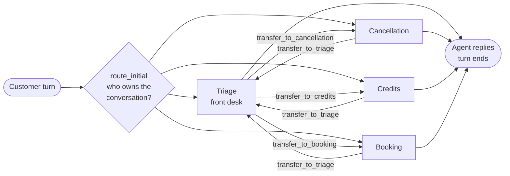
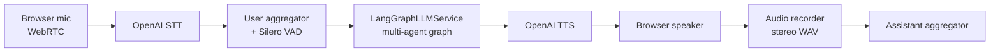

<div align="center">

# 🏋️ LangGym · AI Customer Voice Agent

**A multi-agent gym support assistant you can type to or talk to.**

One LangGraph brain, four cooperating agents, two front ends: a web chat and a real-time voice bot you can interrupt mid-sentence.

[](https://www.python.org/)
[](https://langchain-ai.github.io/langgraph/)
[](https://github.com/pipecat-ai/pipecat)
[](https://fastapi.tiangolo.com/)
[](https://smith.langchain.com/)
[](https://docs.astral.sh/uv/)

[Architecture](#architecture) · [Quickstart](#quickstart) · [Voice mode](#voice-mode) · [Evaluation](#evaluation) · [Design notes](#design-notes)

</div>

---

## Overview

LangGym is a customer-support agent for a fictional gym. A front-desk **triage** agent works out what the customer needs and hands them to one of three specialists: **cancellation**, **credits**, or **booking**. Each agent is its own node in a LangGraph `StateGraph`, with its own prompt and its own tools, and they pass the conversation between each other through handoff tools.

The same compiled graph powers two front ends:

- 💬 **Text chat**: a FastAPI server and a one-page UI that shows which agent you're currently talking to.
- 🎙️ **Voice bot**: a Pipecat pipeline over WebRTC (speech-to-text → the graph → text-to-speech) with barge-in.

Every turn can be traced in LangSmith, and an evaluation harness checks routing, latency and hallucination against the live model.

## Highlights

- **Handoffs as real graph edges.** Agents transfer control with `Command(goto=..., graph=Command.PARENT)`, so every handoff is an edge in the graph and a visible step in the trace.
- **Routing recovered from the transcript.** The active agent is read back from the most recent `transfer_to_*` tool call. The same graph runs with a checkpointer for text and fully stateless for voice.
- **Voice without a second brain.** A custom `LangGraphLLMService` drops the graph into Pipecat's LLM slot. Only the agent's final answer is spoken; tool-calling steps are traced and stay silent.
- **Safe interruptions.** In voice mode Pipecat's context is the single source of truth, so cutting the bot off mid-sentence can't leave routing out of sync with what was actually said.
- **Grounded evals.** Replies are checked against the data store itself (real credit counts, real class names) instead of hardcoded expected strings.
- **Call recording.** Each voice session is saved as a stereo WAV (caller on the left channel, bot on the right) for later review.

## Architecture

### The agent graph



Every turn re-enters the graph at `START`. `route_initial` reads the transcript to find which agent owns the conversation and jumps straight to it, so a customer stays with the booking agent across several turns without the graph ever pausing inside a node. An agent ends the turn by replying without a tool call. Calling a `transfer_to_*` tool moves the turn to another node instead.

| Agent | Responsibility | Tools |
| --- | --- | --- |
| **Triage** | Greets the customer, identifies intent, routes | `transfer_to_cancellation`, `transfer_to_credits`, `transfer_to_booking` |
| **Cancellation** | Cancels a membership | `cancel_membership`, `transfer_to_triage` |
| **Credits** | Reports remaining credits by type | `check_credits`, `transfer_to_triage` |
| **Booking** | Shows the schedule, confirms a date, books the class | `list_classes`, `book_class`, `transfer_to_triage` |

A handoff forwards only the AI message that triggered it plus a `ToolMessage` closing the call. The receiving agent sees a short, valid history without the sending agent's internal tool loop.

### The voice pipeline



In voice mode the graph is compiled without a checkpointer. On each turn `LangGraphLLMService`:

1. converts Pipecat's context into LangChain messages,
2. streams the graph with `astream_events` and voices only the text deltas from the agents' `model` nodes,
3. writes the turn's tool-call exchange back into Pipecat's context, so the next turn still knows which agent is active.

Silero VAD marks where each user turn ends and lets the caller interrupt the bot.

## Tech stack

| Layer | Technology |
| --- | --- |
| Agent orchestration | LangGraph `StateGraph`, LangChain `create_agent` |
| LLM | Claude Sonnet 4.6 via `langchain-anthropic` |
| Voice pipeline | Pipecat (WebRTC transport, Silero VAD, prebuilt browser client) |
| Speech | OpenAI speech-to-text and text-to-speech |
| Web API | FastAPI, Uvicorn |
| Observability | LangSmith |
| Packaging | uv, Hatchling |

## Quickstart

**Prerequisites:** Python 3.11+, [uv](https://docs.astral.sh/uv/), an Anthropic API key, and an OpenAI API key if you want voice.

```bash
git clone https://github.com/kushagra0526/GYM-AI-Customer-Voice-Agent.git
cd GYM-AI-Customer-Voice-Agent
uv sync
cp .env.example .env
```

Then fill in `.env`:

| Variable | Needed for | Notes |
| --- | --- | --- |
| `ANTHROPIC_API_KEY` | Everything | The agents run on `claude-sonnet-4-6` |
| `OPENAI_API_KEY` | Voice mode | Speech-to-text and text-to-speech |
| `LANGSMITH_TRACING`, `LANGSMITH_API_KEY` | Optional | Set tracing to `true` and add a key to see handoffs in LangSmith |
| `LANGSMITH_PROJECT` | Optional | LangSmith project name |
| `HOST`, `PORT` | Optional | Text server address, default `127.0.0.1:8000` |

### Text chat

```bash
uv run pipecat-langgraph-example
```

Open **http://127.0.0.1:8000** and start chatting. The badge under the title shows which agent is handling you right now.

The chat is also a plain JSON API:

```bash
curl -X POST http://127.0.0.1:8000/chat \
  -H "Content-Type: application/json" \
  -d '{"thread_id": "demo-1", "message": "How many credits do I have? My ID is MEM-42"}'
```

```json
{ "reply": "...", "active_agent": "credits" }
```

Send the same `thread_id` again to continue that conversation.

### Voice mode

```bash
uv run python -m gym_support.voice
```

Open the URL it prints (**http://localhost:7860** by default), click **Connect**, allow the microphone and start talking. The bot opens with a fixed greeting, and you can interrupt it at any point. When you disconnect, the path to the session recording is printed in the logs.

### Things to try

| Say or type | Handled by | What happens |
| --- | --- | --- |
| "I want to cancel my membership" | Cancellation | Asks for a membership ID, cancels it, reminds you that you can rejoin |
| "How many credits do I have left?" | Credits | Reports group-class, personal-training and guest-pass credits |
| "I'd like to book a class" | Booking | Shows the schedule, asks for a date, books it and spends one credit |
| "Actually, can I check my credits?" *(mid-booking)* | Booking → Triage → Credits | The specialist hands back to triage, which re-routes you |

> [!NOTE]
> All data is mocked in memory (`mock_data.py`). Any membership ID works, each new member starts with 8 group-class credits, 2 personal-training credits and 3 guest passes, and everything resets when the server restarts.

## Evaluation

```bash
uv run gym-support-eval
```

The harness runs scripted multi-turn conversations through the real graph and the real model, then prints pass/fail, the final agent and latency for each case.

| Case | What it checks |
| --- | --- |
| `cancel_membership` | Routes to cancellation and the reply confirms the cancellation |
| `check_credits` | Routes to credits and every credit count in the store appears in the reply |
| `book_class` | Routes to booking and the reply names the real class and the correct remaining credits |
| `mid_conversation_handoff` | Starts a cancellation, switches to credits, and checks re-routing through triage plus grounded counts |

Hallucination checks read the live `mock_data` store after the conversation, so they verify what the agent said against what actually happened, and keep working if the default credit bundle changes.

There is also one **exploratory** case with no pass/fail: a question none of the specialists covers (a towel-deposit refund). Triage has no "hand off to a human" route yet, so this case records how the agent behaves in that gap.

> Requires `ANTHROPIC_API_KEY`. The eval calls the real model.

## Observability

With `LANGSMITH_TRACING=true`, LangChain and LangGraph report to LangSmith with no extra code. Each turn, text or voice, becomes one trace. A handoff shows triage calling a `transfer_to_*` tool and then the specialist's node running, so the routing decision and the specialist's work sit side by side in the tree.

## Project structure

```
src/gym_support/
├── graph.py                  # the four agents wired as graph nodes, plus routing
├── tools.py                  # business tools and transfer_to_* handoff tools
├── prompts.py                # one system prompt per agent
├── mock_data.py              # in-memory membership store and class schedule
├── server.py                 # FastAPI text chat: GET / (UI) and POST /chat
├── voice.py                  # Pipecat voice bot running the same graph
├── langgraph_llm_service.py  # adapter that runs the graph as Pipecat's LLM stage
├── eval.py                   # routing, latency and hallucination checks
└── static/
    └── index.html            # chat UI with live active-agent badge
```

## Design notes

**Why agents as separate nodes?** Each specialist gets a short prompt and only the tools it needs. That keeps every model call's choices narrow, and it turns each handoff into an edge you can inspect in a trace.

**Why derive routing from the transcript?** When a caller interrupts, Pipecat's context records only what was actually said. Keeping routing in that same context, by reading the last `transfer_to_*` call, means routing and conversation can never drift apart. The text server still uses a checkpointer so it only has to send the newest message each turn.

**Why persist only the tool exchange in voice mode?** The adapter writes the tool-call messages and their results back into Pipecat's context and lets Pipecat's assistant aggregator record the spoken reply. That keeps the history in a valid order: user → tool call → tool result → answer.

## Roadmap

- [ ] Human-escalation route for out-of-scope requests (the exploratory eval case)
- [ ] A real membership database in place of the in-memory store
- [ ] Persistent checkpointer (SQLite or Postgres) for the text server
- [ ] Phone support through a telephony transport such as Twilio
- [ ] More eval cases, including voice-specific ones such as barge-in mid-handoff

## Author

Built by **[@kushagra0526](https://github.com/kushagra0526)**. If you find this project useful, a ⭐ helps others find it.
